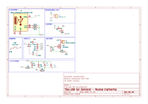
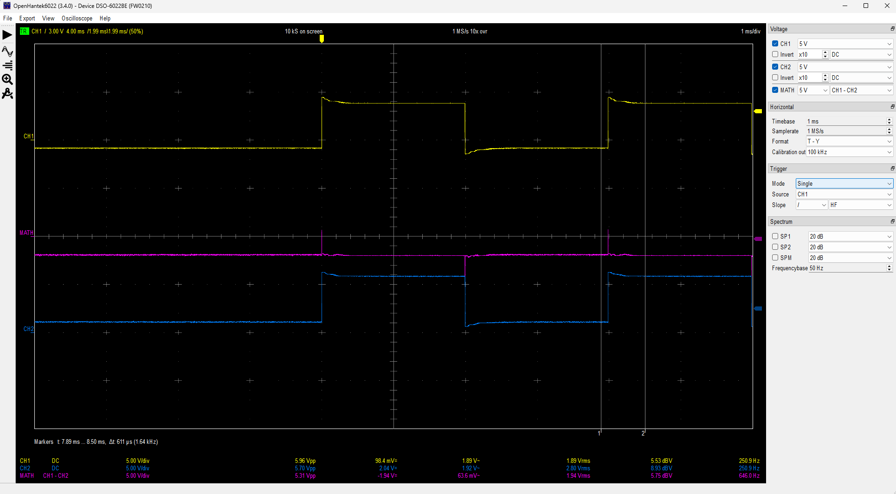
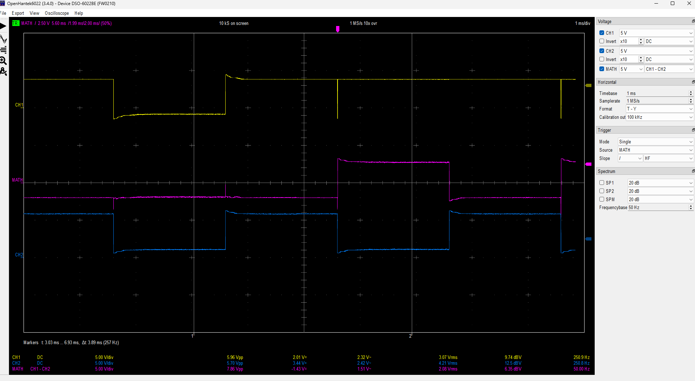

# usb-fan-controller-reserve

USB 风扇控制板的逆向工程记录，包含根据实物 PCB 重建的 KiCad 原理图、PDF 和 SVG 预览。

## 原理图

[查看 SVG 大图](docs/usb-fan-ctrl.svg) · [下载 PDF 原理图](docs/usb-fan-ctrl.pdf)

## 实物 PCB

## 文件

- [KiCad 原理图](hardware/usb-fan-ctrl.kicad_sch)
- [KiCad 工程](hardware/usb-fan-ctrl.kicad_pro)
- [PDF 原理图](docs/usb-fan-ctrl.pdf)
- [SVG 原理图](docs/usb-fan-ctrl.svg)

原理图由 KiCad 10.0 保存，建议使用 KiCad 10.0 或兼容版本打开工程。

## 逆向记录

### 供电、按键与风扇驱动

- USB Type-C 提供 5 V 电源，经二极管保护和电容滤波后为 U1 的 VDD 供电。
- 按键按下时将 U1 的挡位输入脚拉低，上拉可能位于芯片内部。
- FAN+ 直连 USB 5 V，U1 输出 PWM 信号控制 FAN− 侧的 MOSFET，调节风扇转速。

### LED 挡位显示

四颗 LED 分为两组，每组各有两颗 LED 反向并联。LED1、LED2 接在 LC2（引脚 2）与 LC3（引脚 3）之间，LED3、LED4 接在 LC6（引脚 6）与 LC3 之间。LC3 是两组共用的驱动端。

下图分别记录了启动时和 1 挡时的 LC2、LC3 波形。

运行时，LC3 输出约 250 Hz、占空比接近 50% 的方波（`CLK`）。以 1 挡为例，LC2 保持高电平，只有在 LC3 为低电平的半周期，LED1 才导通。到 2 挡，LC2 与 LC3 反相（`~CLK`），LED1、LED2 在两个半周期交替导通，肉眼看起来两颗都亮。若一组 LED 两端的方波同相，两颗都熄灭。

| 挡位 | LC2 | LC3 | LC6 | 实物观察 |
|---|---|---|---|---|
| 关闭 | 低 | 低 | 低 | 全灭 |
| 1 挡 | 高 | CLK | CLK* | LED1 亮 |
| 2 挡 | ~CLK | CLK | CLK* | LED1、LED2 亮 |
| 3 挡 | ~CLK† | CLK | 高 | LED1、LED2、LED3 亮 |
| 4 挡 | ~CLK† | CLK | ~CLK | 四颗全亮 |

\* 1、2 挡已测得 LC6 输出方波，与 LC3 同相是根据 LED3、LED4 均熄灭推断的。  
† 3、4 挡的 LC2 相位沿用 2 挡实测结果，尚未逐挡独立复核。

## 许可证

本仓库内容采用 [MIT 许可证](LICENSE)。
