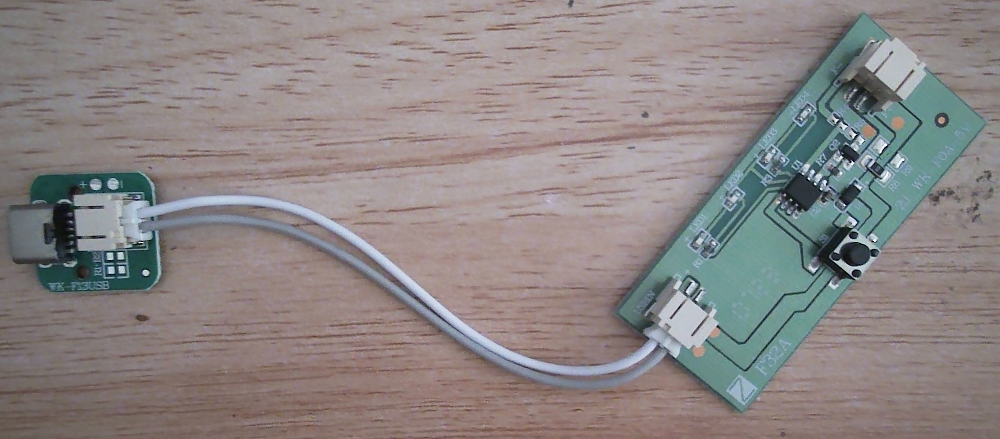

# usb-fan-controller-reserve

USB 风扇控制板的逆向工程记录，包含根据实物 PCB 重建的 KiCad 原理图、PDF 和 SVG 预览。

## 原理图

[查看 SVG 大图](docs/usb-fan-ctrl.svg) · [下载 PDF 原理图](docs/usb-fan-ctrl.pdf)

## 实物 PCB

## 文件

- [KiCad 原理图](hardware/usb-fan-ctrl.kicad_sch)
- [KiCad 工程](hardware/usb-fan-ctrl.kicad_pro)
- [PDF 原理图](docs/usb-fan-ctrl.pdf)
- [SVG 原理图](docs/usb-fan-ctrl.svg)

原理图由 KiCad 10.0 保存，建议使用 KiCad 10.0 或兼容版本打开工程。

## 逆向记录

当前原理图版本为 Rev 0.1，日期为 2026-11-16。原理图根据实物 PCB 重建，U1 的具体型号尚未确认。本仓库提供原理图和实物照片，不包含 PCB 布局设计文件。

## 许可证

本仓库内容采用 [MIT 许可证](LICENSE)。
